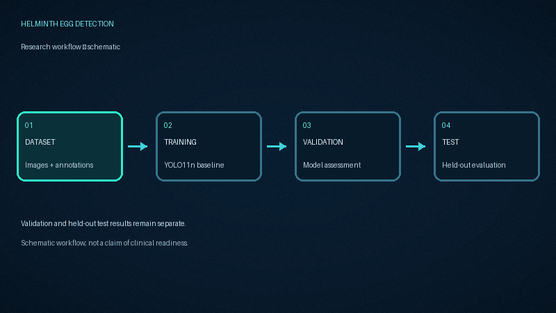
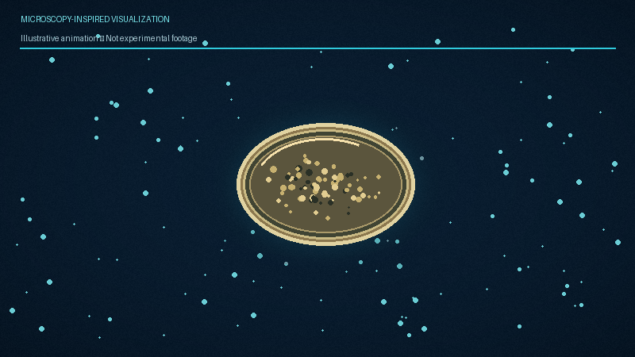

## Animated Research Workflow

## Microscopy-Inspired Visualization

## Illustrative Prediction Demo

*These are illustrative animations, not experimental microscopy footage or verified model predictions.*

https://doi.org/10.5281/zenodo.13843815

# Helminth Egg Detection Using YOLO11n

## Project overview
A preliminary object-detection experiment for four helminth egg classes in microscopy images using YOLO11n.

## Dataset
- Name: Soil-transmitted Helminths and Schistosoma mansoni Eggs Image Dataset
- Source: https://zenodo.org/records/13843815
- DOI: https://doi.org/10.5281/zenodo.13843815
- Selected sample: 400 image-annotation pairs
- Split: 280 training, 60 validation, 60 test images
- Split seed recorded in training configuration: 42

## Model and training
- Architecture: YOLO11n, pretrained weights
- Input size: 320 × 320
- Epochs configured: 15
- Batch size: 4
- Device: CPU
- Optimizer: Ultralytics auto
- Training software: Ultralytics 8.4.181
- Python: 3.13.16
- PyTorch: 2.11.0+cpu

## Classes
- ASC. — Ascaris lumbricoides
- HKW. — Hookworm
- SCH. — Schistosoma mansoni
- TRI. — Trichuris trichiura

## Held-out test results
Evaluation on 60 test images containing 147 annotated instances:
- Precision: 74.77%
- Recall: 64.40%
- mAP@50: 72.50%
- mAP@50–95: 55.26%

### Per-class AP@50
| Class | AP@50 |
|---|---:|
| Ascaris lumbricoides | 95.32% |
| Hookworm | 54.93% |
| Schistosoma mansoni | 58.90% |
| Trichuris trichiura | 80.85% |

The saved model was re-evaluated on the same test split and reproduced the recorded aggregate metrics using Ultralytics 8.4.182. This verifies repeatability of that evaluation in the current environment, not independent external validation.

## Project contents
- `models/best.pt`: trained model weights
- `predict.py`: prediction script
- `dataset.yaml`: dataset configuration
- `results/test_metrics.json`: aggregate metrics
- `results/classwise_test_results.csv`: class-wise AP@50
- `results/training_history.csv`: training history
- `results/training_args.yaml`: training configuration
- `figures/`: evaluation plots

## Reproducibility notes
The training configuration records a random seed of 42 and deterministic mode enabled. Exact reproduction can still depend on software versions, hardware, data files, and library behavior. The training data path in the original configuration differs from the current Google Drive path; update `dataset.yaml` for your own environment before evaluation or prediction.

## Limitations
This is a preliminary experiment on a selected 400-image sample. These results do not establish clinical diagnostic performance. Exact duplicate checks found no cross-split duplicates, but microscopy-slide/source-level independence has not been verified. A visually reviewed similar-image pair was distinct. Further source-level leakage assessment, stronger baseline comparisons, repeated experiments, and independent external validation are needed before making generalization claims.

## Citation
Oyibo et al. (2025), Scientific Reports:
https://doi.org/10.1038/s41598-025-02755-9

Dataset DOI:

