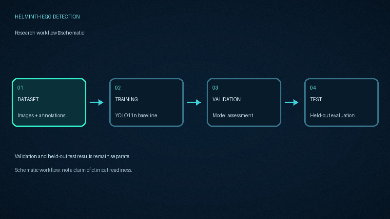
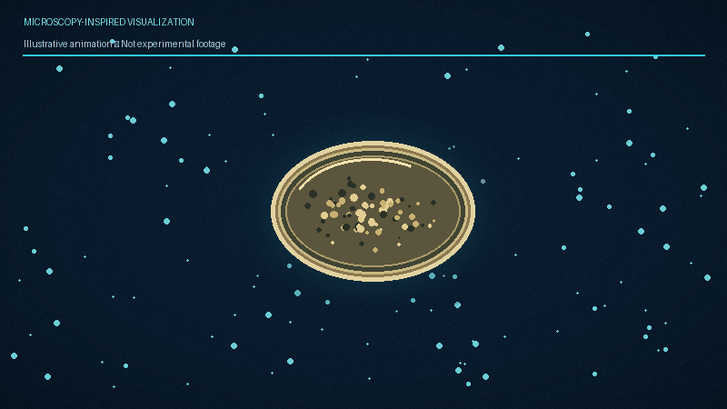

<div align="center">

# HELMINTH EGG DETECTION
### YOLO11n · Computer Vision · Microscopy · Scientific Research

**A preliminary four-class object-detection study in faecal-smear microscopy**

[](https://docs.ultralytics.com/)
[](https://doi.org/10.5281/zenodo.13843815)
[](#limitations-and-responsible-use)
[](https://github.com/ultralytics/ultralytics)

*An experimental study of automated localization and classification of helminth egg categories in microscopy images.*

</div>

---

## Animated project overview

<div align="center">

### Research workflow


### Microscopy-inspired animation


### Illustrative detection-style animation


</div>

> **Visual disclaimer:** The microscopy-inspired animation is synthetic/illustrative. The detection-style animation is not presented as verified output from the trained checkpoint. These assets are for visual communication only.

## 1. Research overview

This repository documents a preliminary object-detection experiment using **YOLO11n** to identify four helminth egg categories in faecal-smear microscopy images. The study uses a selected subset of a publicly available annotated dataset and preserves training, validation, and test partitions.

Research objectives:

- Establish a lightweight object-detection baseline.
- Evaluate localization and category-level detection on a retained test split.
- Document mathematical concepts behind bounding-box detection and evaluation.
- Preserve configuration, metrics, model artefacts, figures, and analysis records.
- Communicate limitations and reproducibility concerns transparently.

## 2. Authors

- **Rayyan Anwar** — Independent Researcher, India
- **Riza Tasleem** — M.Sc. Zoology, Semester 2; Haldaur Degree College, affiliated with Guru Jambeshwar University, India

## 3. Dataset and classes

**Source dataset:** Soil-transmitted Helminths and *Schistosoma mansoni* Eggs Image Dataset.

- Zenodo record: [13843815](https://zenodo.org/records/13843815)
- DOI: [10.5281/zenodo.13843815](https://doi.org/10.5281/zenodo.13843815)
- Selected image–annotation pairs: **400**
- Split: **280 training / 60 validation / 60 test**
- Recorded split seed: **42**

| Class ID | Label | Organism |
|---:|---|---|
| 0 | ASC. | *Ascaris lumbricoides* |
| 1 | HKW. | Hookworm |
| 2 | SCH. | *Schistosoma mansoni* |
| 3 | TRI. | *Trichuris trichiura* |

The project uses the dataset's existing labels. Annotation validity and specimen/slide-level independence have not been independently established in this project.

## 4. Model and training configuration

| Parameter | Recorded setting |
|---|---|
| Model | YOLO11n |
| Initialization | Pretrained weights |
| Image size | 320 × 320 |
| Configured epochs | 15 |
| Batch size | 4 |
| Training device | CPU |
| Seed | 42 |
| Deterministic mode | Enabled in recorded configuration |
| Optimizer setting in YAML | Automatic |
| Framework | Ultralytics 8.4.181 |

**Training provenance caveat:** Saved checkpoint metadata records AdamW and learning rate 0.00125, while the training configuration records optimizer selection as automatic and initial learning rate 0.01. Effective optimizer and learning-rate settings have not been independently reconciled. The exact original training runtime is not fully verified.

## 5. Mathematical foundations

These equations describe common object-detection concepts and evaluation metrics; they are explanatory and do not imply a custom implementation of these calculations.

### 5.1 Bounding-box parameterization

A box may be represented by its center, width, and height:

\[
B=(x_c,y_c,w,h)
\]

Alternatively, corner coordinates can be written as \((x_1,y_1,x_2,y_2)\). Coordinate normalization and conventions depend on the annotation/model format.

### 5.2 Intersection over Union (IoU)

IoU measures the overlap between a predicted bounding box and a reference annotation:

\[
\operatorname{IoU}(B_p,B_{gt})=
\frac{|B_p\cap B_{gt}|}{|B_p\cup B_{gt}|}
\]

An IoU of 1 indicates identical boxes. Detection evaluation uses an IoU threshold as part of the match criterion.

### 5.3 Precision and recall

\[
\operatorname{Precision}=\frac{TP}{TP+FP}
\qquad
\operatorname{Recall}=\frac{TP}{TP+FN}
\]

where TP denotes true-positive detections, FP false positives, and FN false negatives under the evaluation matching protocol.

### 5.4 Average Precision (AP)

Average Precision summarizes a class-specific precision–recall curve:

\[
AP=\int_0^1 P(R)\,dR
\]

In practice, AP is numerically estimated from the precision–recall curve.

### 5.5 Mean Average Precision (mAP)

For \(C\) classes:

\[
mAP=\frac{1}{C}\sum_{c=1}^{C} AP_c
\]

- **mAP@0.50:** AP at IoU threshold 0.50.
- **mAP@0.50–0.95:** AP averaged over IoU thresholds 0.50 to 0.95 in increments of 0.05.

Detection metrics are not equivalent to patient-level sensitivity, specificity, or clinical diagnostic accuracy.

## 6. Held-out test evaluation

The retained documented evaluation used **60 test images and 147 annotated instances**.

**Evaluation settings:** image size 320; confidence threshold 0.001; NMS IoU threshold 0.45; Ultralytics 8.4.181. The test subset was also used in exploratory evaluations under other settings during development; possible test-set reuse is disclosed as a limitation.

### Aggregate results — documented 5 November 2026 evaluation

| Metric | Result |
|---|---:|
| Precision | 77.56% |
| Recall | 63.89% |
| mAP@0.50 | 73.48% |
| mAP@0.50–0.95 | 55.84% |

### Class-wise AP

| Category | AP@0.50 | AP@0.50–0.95 |
|---|---:|---:|
| *Ascaris* (ASC.) | 95.39% | 76.73% |
| Hookworm (HKW.) | 55.06% | 46.38% |
| *S. mansoni* (SCH.) | 62.68% | 40.02% |
| *Trichuris* (TRI.) | 80.78% | 60.21% |

Class-wise performance is not uniform; Hookworm and *S. mansoni* show lower AP in this retained evaluation. The results are estimates on a small selected sample, not clinical validation.

### Separate error-analysis record

A separate analysis (confidence 0.25, NMS IoU 0.70, ground-truth matching IoU 0.50) reported:

| Count | Value |
|---|---:|
| TP | 107 |
| FP | 37 |
| FN | 40 |
| Images | 60 |

These counts use a different protocol and must not be combined directly with the aggregate evaluation above.

### Other retained evaluation

An earlier standardized evaluation dated 23 October 2026 used NMS IoU 0.70 and recorded P 74.77%, R 64.40%, mAP@0.50 72.50%, and mAP@0.50–0.95 55.26%. Because the evaluation settings differ, the two records are not a controlled like-for-like comparison.

## 7. Inference example

```python
from ultralytics import YOLO

model = YOLO("models/best.pt")

results = model.predict(
    source="sample_microscopy.jpg",
    imgsz=320,
    conf=0.25,
    save=True
)

for result in results:
    for box in result.boxes:
        class_id = int(box.cls.item())
        confidence = float(box.conf.item())
        xyxy = box.xyxy[0].tolist()
        print(class_id, confidence, xyxy)
```

The confidence threshold in this example is illustrative; it is not the threshold used for the documented aggregate test metrics.

## 8. Dataset configuration template

```yaml
path: /path/to/dataset
train: images/train
val: images/val
test: images/test
names:
  0: ASC.
  1: HKW.
  2: SCH.
  3: TRI.
```

Set the dataset root to your local environment. Keep class IDs consistent with the annotations. The tracked project configuration and provenance records should not be overwritten casually.

## 9. Repository map

| Path | Purpose |
|---|---|
| `models/best.pt` | Trained checkpoint |
| `predict.py` | Inference script |
| `dataset.yaml` | Dataset configuration |
| `results/` | Metrics, training records, audits, diagnostics |
| `figures/` | Evaluation plots |
| `research_figures/` | Manuscript figure assets |
| `assets/` | README animation and illustrative visual assets |
| `manuscript/` | Manuscript/contributor documentation |
| `notebooks/` | Research notebook(s) |

See the repository files for the detailed audit trail and additional outputs.

## 10. Reproducibility

- Recorded training configuration: seed 42 and deterministic mode.
- Preserve the original checkpoint and its SHA-256 record.
- Record software versions, data paths, evaluation settings, and output artifacts for new runs.
- Do not overwrite earlier evaluation records when results change; retain and explain protocol differences.
- The original data path is environment-specific; configure it for the local machine.
- A fixed seed does not guarantee identical results across different software and hardware.

## 11. Limitations and responsible use

1. The study uses a selected sample of 400 image–annotation pairs.
2. Patient-, specimen-, and slide-level independence across splits is not established.
3. Dataset annotations have not been independently verified in this project.
4. Exploratory test-set reuse occurred; possible test-set reuse may affect interpretation.
5. External validation and additional baseline comparisons are not available in the current study.
6. The metrics do not establish clinical diagnostic accuracy or clinical utility.
7. The model is **not validated for routine laboratory or clinical deployment**.

Further work should include expert annotation review, data-source and specimen-level leakage checks, repeated runs, stronger baseline comparisons, and independent external validation.

## 12. Ethics, funding, and competing interests

This work is a secondary computational analysis of an existing public dataset. No new participants were recruited and no new specimens were collected for this project. The original dataset documentation reports ethics approval and informed consent for the underlying study; these records were not independently audited for this secondary analysis.

The current project received no specific funding. Funding attributed to the source dataset-generating study is not claimed as funding for this project. No specific financial or non-financial competing interests are declared.

## 13. Data availability and citations

The source dataset is available through [Zenodo record 13843815](https://doi.org/10.5281/zenodo.13843815), subject to the dataset licence and terms.

**Related publication:** Oyibo et al. (2025), *Scientific Reports*.  
[https://doi.org/10.1038/s41598-025-02755-9](https://doi.org/10.1038/s41598-025-02755-9)

## 14. Project disclaimer

This repository is a research record for a preliminary computer-vision experiment. It is **not a medical device** and must not be used as a substitute for expert microscopy, laboratory procedures, or clinical diagnosis.

---

<div align="center">

**COMPUTER VISION · MICROSCOPY · REPRODUCIBLE RESEARCH**

*Transparent reporting · Scientific caution · Computational experimentation*

</div>
